# Architecture diagrams

Codec is a chat app for a small group of friends running their own Matrix server. These pictures show how it works.
Each one has a few plain lines above it saying what it shows and below it saying what to take away.

**Which picture answers your question?**

| You are wondering about | Look at |
|---|---|
| What talks to what | 1 |
| Where a piece of code belongs, what may import what | 2 |
| Login, loading screen, "Session expired" | 3 and 4 |
| A message not showing up, or showing late | 5 |
| Sending, local echo, "sending" vs "sent" | 6 |
| Images not loading, voice notes | 7 |
| A thread, replies missing from the channel | 8 |
| "Unable to decrypt", the security banner, recovery keys | 9 |
| Link cards and "Show preview" | 10 |
| A voice call from ring to "Call ended" | 11 |
| Phone layout, drawers, the Android back button | 12 |
| The beta at 704.chat: which box runs what | 13 |

The diagrams are [Mermaid](https://mermaid.js.org/). GitHub renders them; in VS Code install a Mermaid preview
extension, or paste one into [mermaid.live](https://mermaid.live). Solid arrows are the normal path, dotted arrows
happen only sometimes (after a click, on an error), and thick arrows carry call audio.

When a diagram and the text disagree, `docs/ARCHITECTURE.md` and `docs/CORE_API.md` win.

1. [The big picture](#1-the-big-picture)
2. [Layers inside the app](#2-layers-inside-the-app)
3. [Signing in and starting up](#3-signing-in-and-starting-up)
4. [Session states](#4-session-states)
5. [How a message reaches the screen](#5-how-a-message-reaches-the-screen)
6. [Sending a message](#6-sending-a-message)
7. [Images, files and voice notes](#7-images-files-and-voice-notes)
8. [Threads](#8-threads)
9. [Encryption and device trust](#9-encryption-and-device-trust)
10. [Link previews](#10-link-previews)
11. [A voice call](#11-a-voice-call)
12. [Screen layout and the back button](#12-screen-layout-and-the-back-button)
13. [Where everything runs (704.chat)](#13-where-everything-runs-704chat)

## 1. The big picture

Codec is a single-page app that runs in the browser (or inside the Capacitor shell on a phone). It talks to one
Matrix homeserver for everything: sign-in, messages, files and link previews. Sign-in can hand off to the
homeserver's SSO provider (Keycloak on the beta). Two kinds of content come straight from third parties: GIFs
(hot-linked from Klipy; in encrypted rooms a GIF loads only after a click) and YouTube / Spotify players inside
link previews.

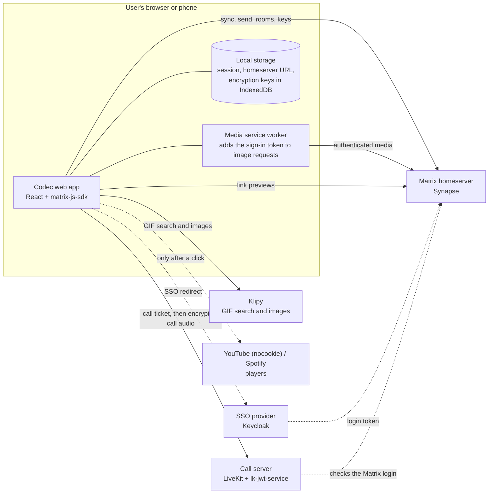

The *media service worker* is a small script the browser runs next to the page. It adds the sign-in token to image
requests, because an `` tag cannot do that itself. Link previews are fetched by the homeserver, not the browser,
so the linked site never sees the user's address. In encrypted rooms GIF images and previews load only after a click.

Voice calls add a call server. Codec finds it in the homeserver's well-known file, asks it for a call ticket, and sends
audio there already encrypted, so the call server only forwards it.

## 2. Layers inside the app

Code is split into four layers, and imports only go downwards. An arrow means "may import from". Feature screens never
send anything through matrix-js-sdk themselves (they only use its types and enums); they read state through store hooks
and change things through the action functions in `src/lib/matrix`.

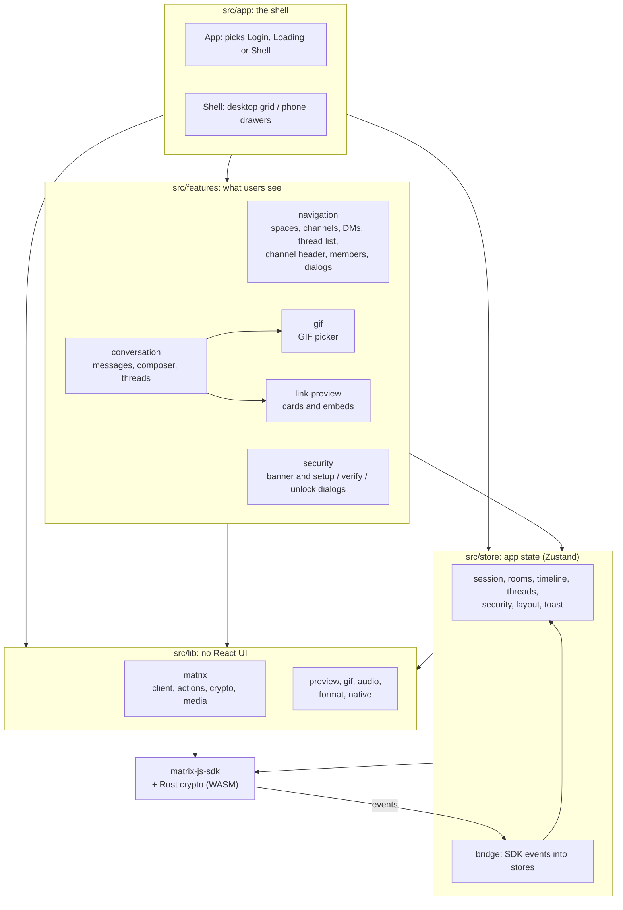

Who owns which folder is in `docs/ARCHITECTURE.md`, "Who works on what".

## 3. Signing in and starting up

On page load the app first registers the media service worker, then tries to resume a saved session. A fresh SSO
login arrives as a `loginToken` in the URL and is swapped for a session. Encryption starts before syncing, because
the SDK needs it ready for the first batch of messages. The loading screen shows two stages: "crypto" then "sync".

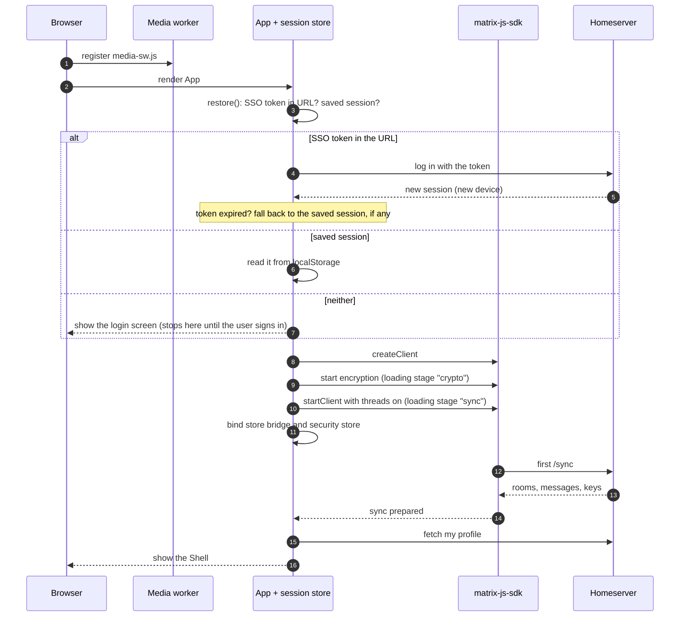

## 4. Session states

The session store's `status` decides which screen is on show. Failures land back on the login form, with a message
when there is something to say (for example "Session expired" when the server revokes the device).

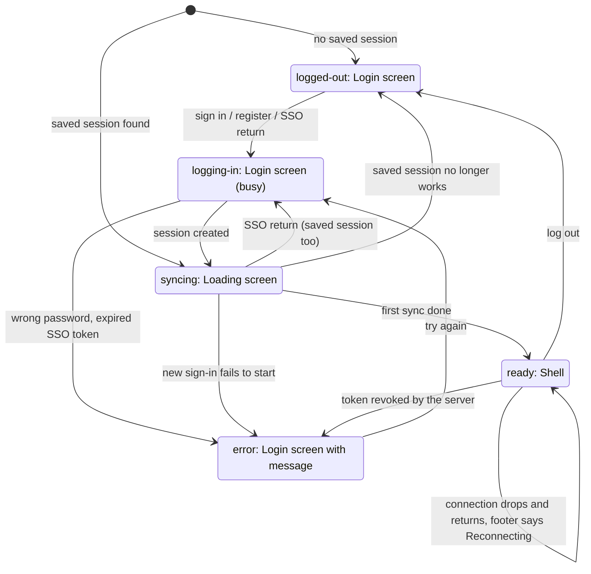

Logging out, or losing the token, also stops the client, wipes this device's encryption store, and clears the room,
timeline, thread, security and link-preview caches, so the next person on the same browser starts clean.

## 5. How a message reaches the screen

matrix-js-sdk keeps the live model of every room. The bridge listens to its events and copies the parts the UI needs
into the stores, batching bursts so React renders once per burst, not once per event (50 ms for the room list,
30 ms for timelines). Components only ever read the stores.

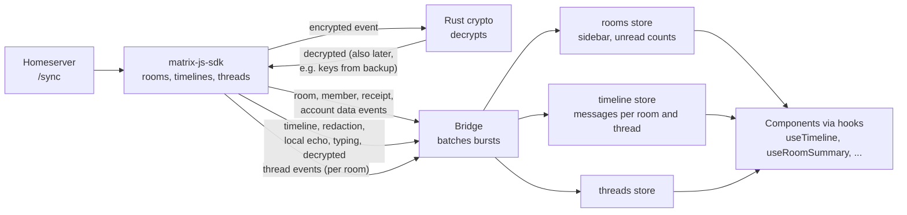

Scrolling up asks the SDK for older messages (`paginateBack`); the results come back through the same path.

Thread replies take a separate path; diagram 8 shows it.

## 6. Sending a message

Features call one action function per kind of message. The SDK shows the message straight away as a "local echo",
encrypts it when the room is encrypted, and sends it. When the server confirms, the echo turns into the real event.

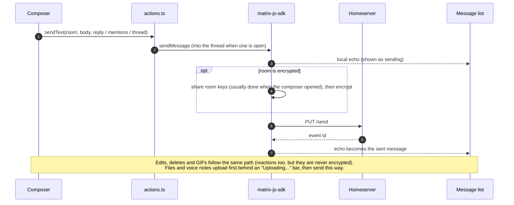

New channels and DMs are encrypted by default; spaces are not (they only hold the channel list).

## 7. Images, files and voice notes

Browsers cannot attach a sign-in token to an ``, so a service worker adds it to media requests for the user's
own homeserver. (Without the worker, for example on a plain-http LAN address, the app falls back to the older
unauthenticated media URLs.) In encrypted rooms files are encrypted in the browser before upload; the server only
stores scrambled bytes and cannot make thumbnails, so the app downloads and decrypts the file itself.

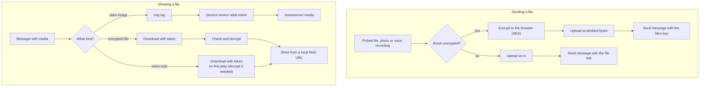

Opening a full image or downloading a file also goes through a token-carrying fetch and a local `blob:` URL, since
those are page navigations the service worker cannot see. Voice notes play from a `blob:` URL too, so seeking works.

## 8. Threads

A reply "in thread" never shows in the channel. The SDK keeps one timeline per thread; only the root stays in the
channel, with a summary row under it. Opening a thread shows a side panel on desktop (in place of the member list) or
a full-screen layer on phones. Scrolling up inside a thread loads older replies the same way as in a channel.

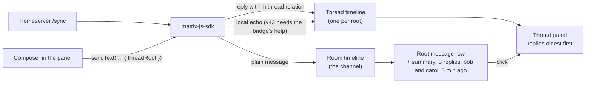

Three facts worth keeping in mind: threads never nest (a reply to a reply still belongs to the root); a thread has its
own unread count, cleared only by reading the thread; and typing indicators are room-wide, because Matrix has none for
threads.

## 9. Encryption and device trust

Encryption runs in matrix-js-sdk's Rust engine. Each sign-in is a new device, with its keys kept in this browser's
IndexedDB. The security store watches the engine and tells the banner what to ask for: set up encryption, verify
this session, unlock your message history with the recovery key, or wait while keys restore.

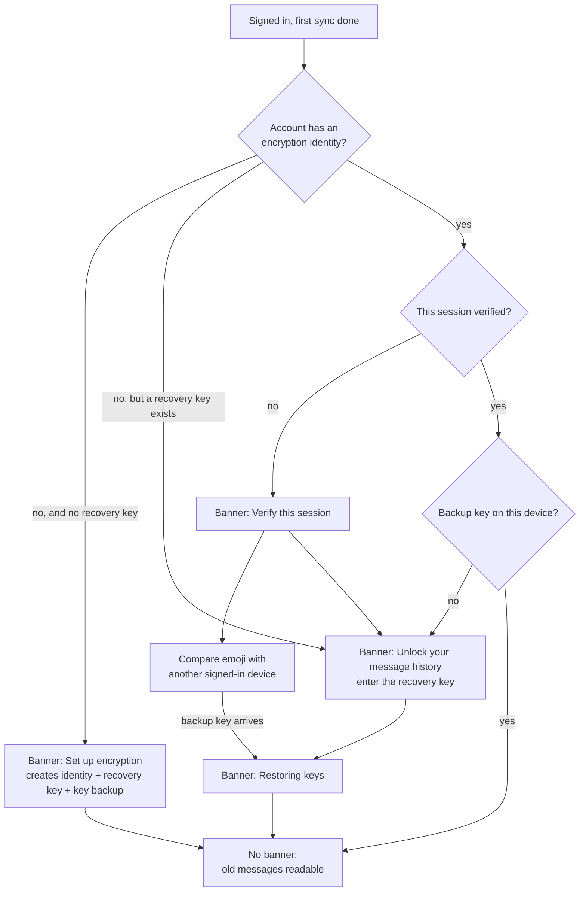

Messages the device has no key for show an "unable to decrypt" row that says why (for example "Sent before you
joined" or "Restoring from backup..."). When there is a fix, the row offers an Unlock or Verify button.

## 10. Link previews

Previews are fetched by the homeserver, not the browser, so the user's IP never reaches the linked site. In an
encrypted room, asking the server for a preview would reveal the link, so nothing is requested until the user clicks
"Show preview" (a preview already in the app's cache still shows). YouTube and Spotify links get a player, which
also loads only on click. Every card has a Hide button, and the choice is remembered.

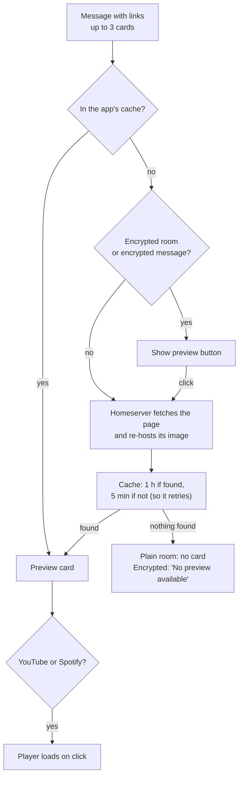

## 11. A voice call

Alice presses the call button in an encrypted DM. Bob's device rings, he accepts, both connect to the call server with
their own encryption keys, and when the last person leaves a "Call ended, 12 min" line lands in the chat. The four grey
chat lines (started, declined, ended, missed) are Matrix events, so every device renders the same history.

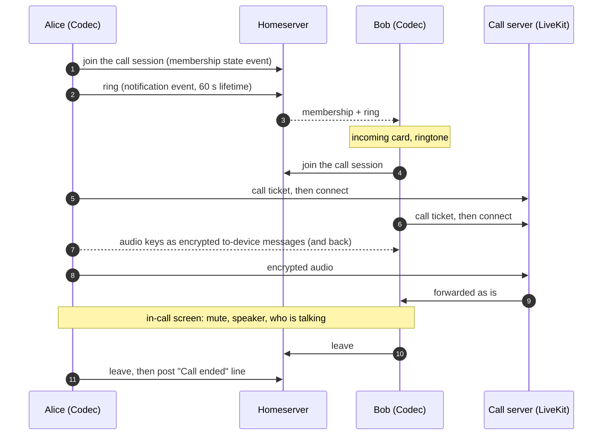

If Bob declines, he posts a decline event and Alice's DM call ends. If nobody answers within 60 s, or Alice hangs up
while still ringing, Alice posts a "missed" line naming who was rung. A ring in another room during a call is declined
automatically as "busy" and never shown.

## 12. Screen layout and the back button

Wide screens show four columns. Phones (under 768 px wide, or touch screens under 1024 px) show one full-screen
conversation with the navigation and member list in slide-in drawers. Both layouts mount the same feature
components; only the shell around them changes.

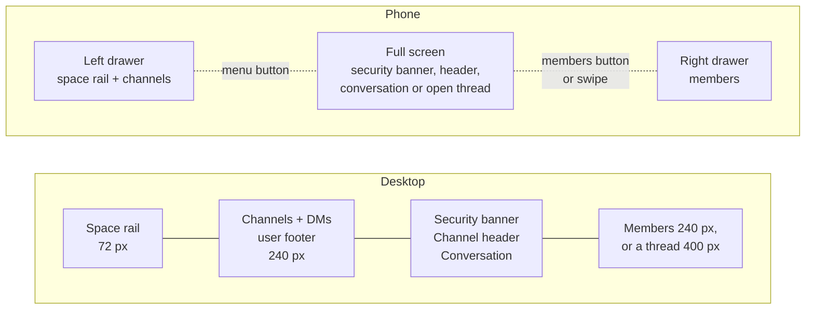

On phones the Android back button closes one thing at a time, from the top down, and only minimises the app when
nothing is open.

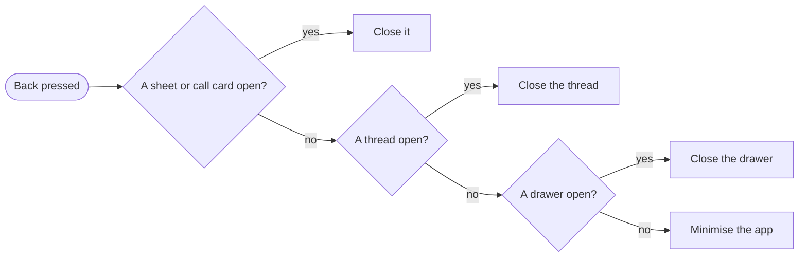

## 13. Where everything runs (704.chat)

The beta's real deployment on JC's homelab, as of 2026-10-19. Web traffic (chat, sign-in, files, call setup) comes in
through the Cloudflare tunnel, and Nginx Proxy Manager sends each name to its box. Cloudflare can't carry live audio,
so call audio comes straight through the home router to LiveKit. New Codec builds go from GitHub through opsbox, where
Hubot builds them and copies the files to LXC 203.

Names in the picture: an *LXC* is a Linux container on the Proxmox server; *opsbox* is the admin machine; *Hubot* is the
ops assistant that deploys; *Nginx Proxy Manager* is the reverse proxy (not the npm package manager). Boxes marked
*planned* are being set up for voice calls (`docs/archive/PHASE7_PLAN.md`, Phase 0).

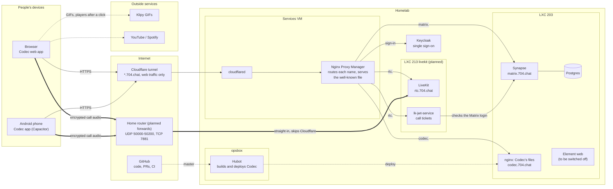
